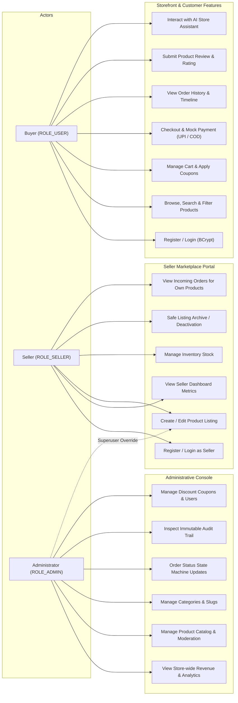
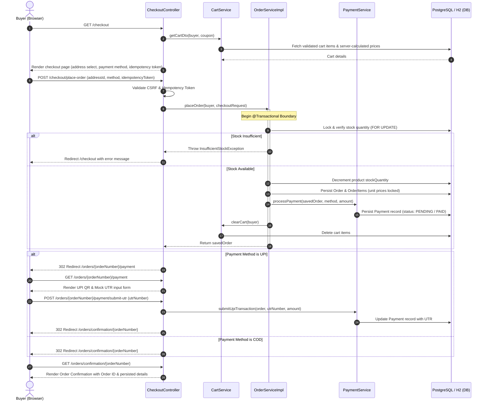

# ShopSphere (ShopSphere) — Architectural Blueprint

## 1. Architectural Style
ShopSphere is architected following the **Clean Layered Architecture** paradigm, ensuring clear separation of concerns, high maintainability, loose coupling, and strict encapsulation of business logic within transactional domain services.

```
+-------------------------------------------------------------------+
|                        Client Browser / Web                       |
|   (Thymeleaf Server-Rendered HTML5, CSS3, Bootstrap 5, JS Fetch)  |
+---------------------------------+---------------------------------+
                                  | HTTP / HTTPS
                                  v
+-------------------------------------------------------------------+
|                     Spring Security 6 Gateway                     |
|    (BCrypt, Role-Based Access Control: ROLE_USER vs ROLE_ADMIN,   |
|         CSRF Protection, Session Management, Remember-Me)         |
+---------------------------------+---------------------------------+
                                  |
                                  v
+-------------------------------------------------------------------+
|                    Presentation / Controller Layer                |
|      (HomeController, ProductController, CartController,          |
|    CheckoutController, OrderController, AdminDashboardController,  |
|          AdminProductController, GlobalExceptionHandler)          |
+---------------------------------+---------------------------------+
                                  | DTOs / View Models
                                  v
+-------------------------------------------------------------------+
|                      Business Service Layer                       |
|       (OrderService, ProductService, CartService, UserService,    |
|       CouponService, PaymentService, FileStorageService)          |
+---------------------------------+---------------------------------+
                                  | Entities / JPA Specifications
                                  v
+-------------------------------------------------------------------+
|                     Data Access / Repository Layer                |
|         (Spring Data JPA Repositories + Hibernate 6 ORM)          |
+---------------------------------+---------------------------------+
                                  | JDBC / Connection Pool (HikariCP)
                                  v
+-------------------------------------------------------------------+
|                         Database Layer                            |
|       PostgreSQL 16 (Production) / H2 In-Memory (Development)     |
|          Automated Schema Migrations via Flyway (V1, V2)          |
+-------------------------------------------------------------------+
```

---

## 2. Core Package Structure

```
com.simson.shopsphere
├── config
│   ├── WebMvcConfig.java             # Static resource handling & file uploads
│   └── OpenApiConfig.java            # Springdoc OpenAPI 3.0 / Swagger UI
├── controller
│   ├── GlobalModelAttributes.java    # Global categories, cart & user context
│   ├── HomeController.java           # Homepage & promotions
│   ├── AuthController.java           # Register, login, forgot password
│   ├── ProductController.java        # Multi-facet search, filtering, details
│   ├── CartController.java           # Cart management & coupon applications
│   ├── WishlistController.java       # Wishlist operations & move to cart
│   ├── AddressController.java        # Multi-address management
│   ├── CheckoutController.java       # Checkout workflow & order placement
│   ├── OrderController.java          # Order history, details & tracking
│   ├── ReviewController.java         # Customer verified reviews
│   ├── ProfileController.java        # User profile & password updates
│   ├── api/                          # REST API Endpoints for AJAX & Swagger
│   │   ├── ApiProductController.java
│   │   ├── ApiCartController.java
│   │   ├── ApiWishlistController.java
│   │   ├── ApiCouponController.java
│   │   ├── ApiChatController.java
│   │   └── ApiHealthController.java
│   ├── seller/                       # Seller Portal (Secured with ROLE_SELLER / ADMIN)
│   │   ├── SellerProductController.java
│   │   └── SellerOrderController.java
│   └── admin/                        # Admin Portal (Secured with ROLE_ADMIN)
│       ├── AdminDashboardController.java
│       ├── AdminProductController.java
│       ├── AdminCategoryController.java
│       ├── AdminOrderController.java
│       ├── AdminUserController.java
│       ├── AdminCouponController.java
│       └── AdminAuditController.java
├── dto                               # Strongly typed Data Transfer Objects
├── entity                            # Normalized JPA Relational Entities & Enums
├── exception                         # Global exception advice & domain errors
├── repository                        # Spring Data JPA interfaces
├── security                          # CustomUserDetails, Services & SecurityConfig
├── service                           # Business interfaces
│   └── impl                          # Transactional service implementations
└── specification                     # Dynamic JPA Specifications for filtering
```

---

## 3. Key Design Principles

1. **Defense in Depth**:
   - Price calculations are executed strictly server-side inside `Product.getDiscountedPrice()`. Any client-side price payload is completely ignored.
   - Stock is reserved atomically inside `@Transactional` order placement methods.
2. **Auditability**:
   - Every administrative modification (product creation, inventory alteration, status change) writes an immutable record to the `audit_logs` table.
3. **Resilience & Safe State Transitions**:
   - Orders follow a strict state machine (`PLACED` -> `CONFIRMED` -> `PACKED` -> `SHIPPED` -> `OUT_FOR_DELIVERY` -> `DELIVERED`).
   - Order cancellations restore the reserved inventory immediately.

---

## 4. AI Chatbot Architecture & Request Flow

```
[Customer Browser / Floating Widget]
              │
              │  POST /api/v1/chat  {"message": "..."}
              ▼
[ApiChatController]
              │
              │  Validates input (length <= 1,000, non-blank)
              ▼
[ChatServiceImpl]
              │
              ├──► [SessionRateLimiter] ──► (10 req/min per session? Exceeded -> HTTP 429)
              │
              ├──► [SessionChatCache]   ──► (Identical normalized question in session? Hit -> Return cached)
              │
              ├──► Provider Selection & Context Assembly
              │         │
              │         ├─ Provider = "gemini" ──► [GeminiChatProvider] (API Key server-side, 10s timeout)
              │         │                               │
              │         │                               ├── Success: parse candidate JSON -> reply
              │         │                               └── Failure/Timeout: catch & fallback ──┐
              │         │                                                                       ▼
              │         └─ Provider = "mock" (or fallback) ──────────────────────────► [MockChatProvider]
              │                                                                           (10 Domain FAQs,
              │                                                                            Scope Boundary)
              ▼
[Response Cache & Envelope] ──► {"success": true, "data": {"reply": "..."}, "error": null}
```

### Architectural Note: Spring Boot vs. Servlet Specification
The ShopSphere platform is built on **Spring Boot 3.3.4 (Java 21, Spring MVC, Spring Security 6, Spring Data JPA)**.
While the academic project guideline originally outlined a raw Servlet-based architecture (`HttpServlet` / `web.xml`), ShopSphere utilizes Spring Boot's modern MVC controller and filter chain (`@RestController`, `@Service`, Spring Security `SecurityFilterChain`, `CookieCsrfTokenRepository`).
The AI Chatbot integration seamlessly follows this Spring Boot paradigm via `ApiChatController` at `POST /api/v1/chat`, dependency-injected `ChatProvider` implementations, thread-safe session-level sliding-window rate limiters, and in-memory expiring caches without introducing conflicting legacy servlets or framework migrations.

---

## 5. System Diagrams

### 5.1 Use Case Diagram (D2: Buyer, Seller, Administrator)



### 5.2 Sequence Diagram (D3: Order Placement & Mock Payment Workflow)



---

## 6. Academic Specification Variance & Architectural Alignment

| Academic PDF Specification Requirement | ShopSphere Implementation Architecture | Architectural Rationale & Faculty Variance Justification |
| :--- | :--- | :--- |
| **Java Platform**: Java 17 | **Java 21 LTS** (Eclipse Adoptium Temurin 21) | Fully backward-compatible superset; utilizes enhanced virtual threads and modern pattern matching. |
| **Server Engine**: Apache Tomcat 9 | **Embedded Apache Tomcat 10.1** (Spring Boot 3.3.4) | Standalone executable deployment; eliminates external WAR deployment friction while utilizing the modern Jakarta EE 10 servlet specification. |
| **Controller Architecture**: Raw Java Servlets (`HttpServlet`, `doGet`, `doPost`) | **Spring Boot MVC Controllers** (`@Controller`, `@RestController`) | Industry-standard declarative routing, robust parameter validation (`@Valid`, Bean Validation), and unified exception management (`@ControllerAdvice`). |
| **Data Access**: Manual JDBC DAO with raw SQL strings | **Spring Data JPA / Hibernate 6 + HikariCP** | Eliminates boilerplate SQL, prevents SQL injection via parameterized HQL/Criteria queries, and provides declarative `@Transactional` integrity. |
| **Database**: MySQL 8.0 | **PostgreSQL 16 (Prod) / H2 In-Memory (Dev/Test)** | Enterprise-grade ACID compliance, advanced indexing, with automated repeatable migrations managed via **Flyway**. |
| **View Technology**: JavaServer Pages (JSP / JSTL) | **Thymeleaf 3 + Bootstrap 5 + Bootstrap Icons** | Modern natural templating engine; prevents scriptlet security vulnerabilities, runs without servlet container coupling, and supports server-side layout fragments. |
| **Security Layer**: Manual `HttpSession` handling & servlet filters | **Spring Security 6.3** | BCrypt password hashing, CSRF token repositories, role-based authorization hierarchies (`hasRole('ADMIN')`, `hasAnyRole('SELLER', 'ADMIN')`), and session fixation protection. |
| **Payment Flow**: University Mock Payment confirmation | **Dedicated Mock Payment Workflow** (UPI QR + Mock UTR submission + COD) | Strict compliance with university guidelines: avoids live third-party financial transactions while delivering an authentic e-commerce payment experience. |
| **AI Integration**: AI / Chatbot Assistant | **Dual-Engine AI Chatbot** (`/api/v1/chat`) | Built with Gemini 2.5 Flash cloud API and an offline 10-FAQ domain-grounded fallback provider, rate limited to 10 requests/min per session. |
| **CI / Observability**: Basic manual test execution | **GitHub Actions CI + `/api/v1/health`** | Automated continuous integration verifying build and 125 automated unit/integration tests with every push. |


